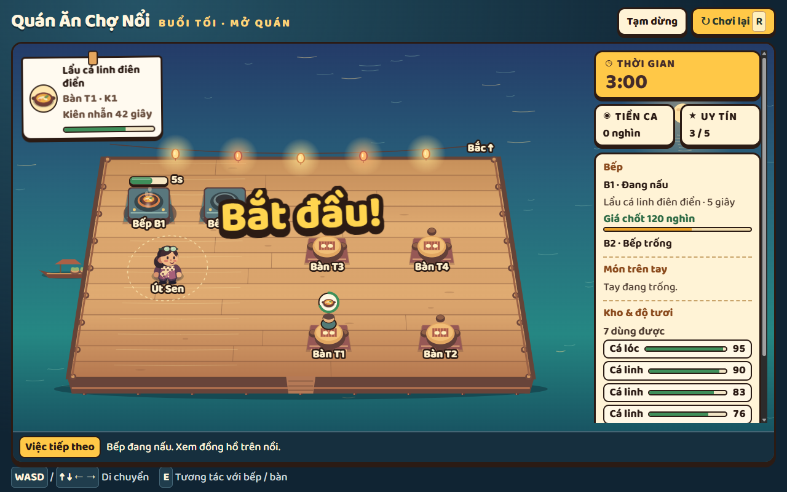

# Kiểm tra lại UI với server thật: lỗi "quán timeout" đã hết (Minhduc7904)

Ngày 21/11/2026, 14:28 (giờ VN). Chạy trên `main` `c4392a3`, gồm tag `v1.0.0` và các PR #50, #51. Máy Windows 11, Chrome headless, Python 3.12.6, `websockets` 17.4.

## Vì sao kiểm tra lại

[ui/README.md](../ui/README.md) mục "Hồi quy" và bản nháp `verification/phase-4.md` (mục "Lỗi đã biết") đều ghi rằng `browser-check.py --mode quan` timeout vì giao món xong khách không sang `eating`, và lỗi này chưa được điều tra. Ghi chú này là trong vùng UI (#5), nên mình kiểm tra lại.

## Nguyên nhân

Lỗi nằm ở script kiểm tra, không phải ở game. Từ Phase 2, quán có thêm khách ngẫu nhiên. Khách C1 xếp trước K1 khi sắp theo id, nhưng script cũ lại chờ `customers[0]` sang `eating`. Commit [`a238425`](https://github.com/tuancdk/K5-L3B-LAB-Day12-AI-SDLC-1111/commit/a238425) (#22, tuancdk) đã sửa thành chờ đúng khách K1 ([browser-check.py:420-421](../../ui/browser-check.py)). Tuấn cũng đã ghi nguyên nhân này trong comment đóng #22. Sau đó (PR #53) Tuấn chạy lại và ghi "không còn tái hiện, nhiều khả năng do PR #44". Theo `git log -S`, thay đổi quyết định là ở script trong `a238425`.

## Kết quả

Lệnh: `python -X utf8 -B docs/proof/ui/browser-check.py --out <thư mục tạm>`. Script tự bật 2 server `chonoi.live` thật (gather, quan) và điều khiển Chrome headless. Ảnh được ghi ra thư mục tạm để không ghi đè bằng chứng cũ.

| Lần | gather | quan | exit |
|---|---|---|---|
| 1 | OK, 233 frame | OK, 484 frame | 0 |
| 2 | OK, 228 frame | OK, 500 frame | 0 |
| 3 | OK, 226 frame | OK, 498 frame | 0 |
| `--day-fixture` | Fixture 1280×720: gather 60.5 FPS, quan 60.5 FPS; full flow, pause and Settings OK | | 0 |

Ảnh chụp lần 1 ở 1280×720:
- [ui-gather-server-that.png](ui-gather-server-that.png)
- [ui-quan-server-that.png](ui-quan-server-that.png): bếp B1 đang nấu "Lẩu cá linh điên điển", có dòng **"Giá chốt 120 nghìn"**. Kho hiện độ tươi của từng cá thể (95, 90, 83, 76…). Phiếu K1 ở bàn T1 có thanh kiên nhẫn.

## Chưa kiểm

`--day-live` (chơi một Ngày thật từ menu tới tổng kết) và `phaser-check.py` chưa chạy lại trong lần này. Tuấn đã ghi hai mục này đạt ở [ui/README.md](../ui/README.md).
