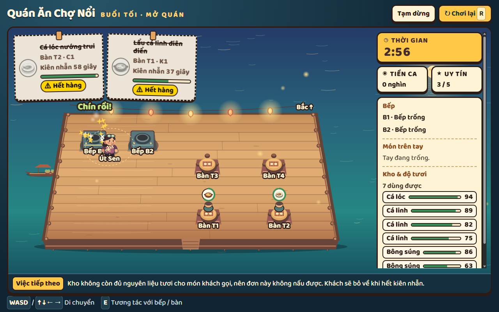

# UI: đơn "hết hàng" (`order_status: "unfulfillable"`) giờ có nhãn và gợi ý (Minhduc7904)

Ngày 21/11/2026, sau tag `phase-4`. Vùng #5 (`chonoi/web/`). Phát hiện khi review PR #44.

## Lỗi

Từ P3 (#20, PR #44), sim quán có trạng thái đơn `unfulfillable`. Trạng thái này xảy ra khi nguyên liệu đang giữ cho khách bị ươn (dưới 30) mà kho không còn cá thể tươi cùng loại để thay. Khi đó:
- đơn **không nấu được**, vì bếp chỉ nhận đơn có `order_status: "reserved"`;
- khách chờ tới hết kiên nhẫn rồi bỏ về, bị **−0.5 uy tín**.

Sim tạo ra trạng thái này thật, xem `tests/test_quan_freshness.py`, ví dụ `test_affected_orders_compete_in_order_tick_then_table_order`. Nhưng `chonoi/web/index.html` không đọc `order_status` ở đâu cả:
- Phiếu món của đơn hết hàng trông **giống hệt** đơn bình thường.
- Dòng gợi ý vẫn ghi "Xem món khách gọi, rồi đến bếp để nấu."

Người chơi sẽ đến bếp bấm E, không có gì xảy ra, rồi bị trừ uy tín mà không hiểu vì sao.

## Sửa (chỉ `chonoi/web/index.html`, không đổi luật hay contract)

- **Phiếu món:** thêm class `blocked`, gồm viền nét đứt, biểu tượng món chuyển xám và tên món bị gạch ngang. Có thêm **nhãn chữ "⚠ Hết hàng"**, nên không chỉ dựa vào màu, cùng nguyên tắc với cảnh báo P4 (#34).
  - Nhãn dùng chữ 18 px như các nhãn cảnh báo khác.
  - Lúc đầu nhãn là "Hết nguyên liệu tươi · không nấu được", nhưng tràn khỏi phiếu rộng 230 px. Rút còn "Hết hàng" và thêm kiểm tra nhãn không tràn.
  - Đơn sắp hết kiên nhẫn vẫn hiện thêm "Sắp giận!".
- **Tương phản cao:** phiếu hết hàng có viền chấm trắng 4 px, phân biệt với viền gạch vàng của phiếu "Sắp giận".
- **Gợi ý "Việc tiếp theo":** khi mọi đơn đang chờ đều hết hàng, gợi ý đổi thành "Kho không còn đủ nguyên liệu tươi cho món khách gọi, nên đơn này không nấu được. Khách sẽ bỏ về khi hết kiên nhẫn."

## Kiểm chứng

- `docs/proof/ui/browser-check.py` có thêm một bước. Bước này đặt mọi khách thành `unfulfillable`, rồi chờ đủ ba điều kiện:
  - mọi phiếu có class `blocked` và chữ "Hết hàng";
  - nhãn không tràn khỏi phiếu;
  - gợi ý có chữ "không nấu được".

  Sau đó bước này chụp ảnh `quan-unfulfillable`. Chạy với server thật (gather + quan): **đạt**, không lỗi JavaScript.
- Ảnh 1280×800: [ui-quan-unfulfillable.png](ui-quan-unfulfillable.png).
- Toàn bộ unittest: xem [unittest.log](unittest.log).

## Chưa làm

- Chưa có cảnh chơi thật dẫn tới `unfulfillable`; mới kiểm bằng cách sửa snapshot trong trình duyệt, theo cách `browser-check.py` vẫn làm.
- Cảnh Phaser (bong bóng món trên bàn) chưa đổi theo trạng thái này.
