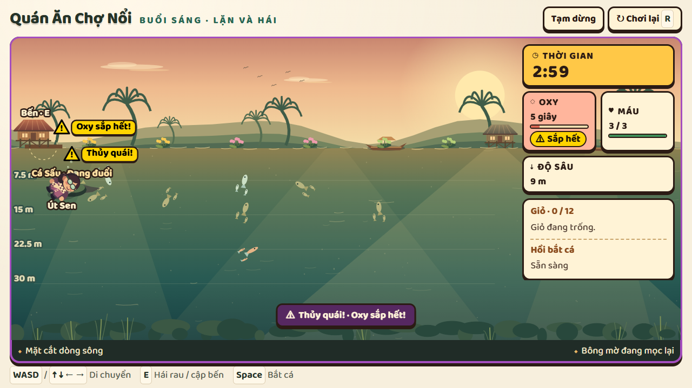
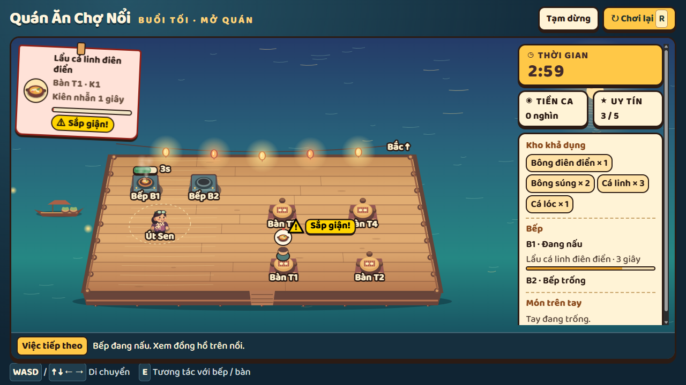
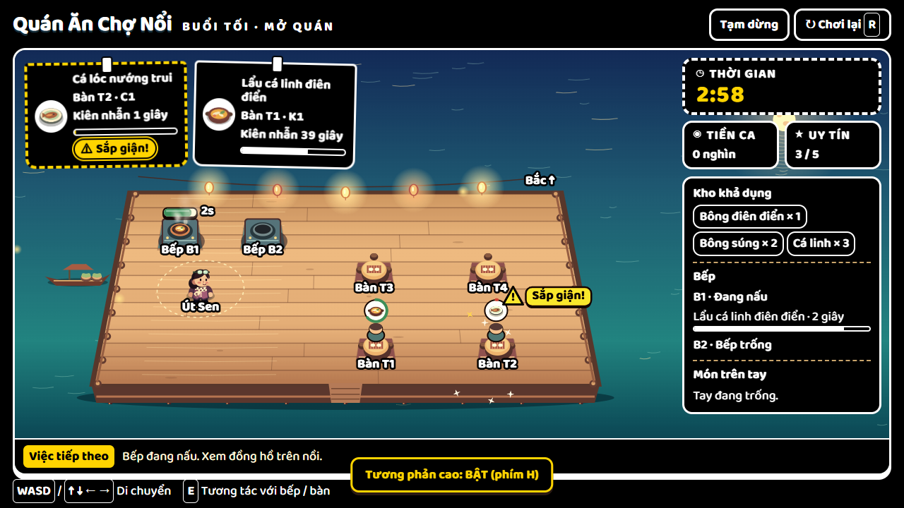

# Bằng chứng Phase 4: cảnh báo dễ nhận biết và tương phản cao (UI)

Ngày 21/11/2026, nhánh `tuancdk/p4-ui-warnings`, [issue #34](https://github.com/tuancdk/K5-L3B-LAB-Day12-AI-SDLC/issues/34).

Phạm vi: `chonoi/web/index.html`. Không đổi luật, contract hay `live.py`, nên headless không bị ảnh hưởng.

## Ba cảnh báo: chữ và biểu tượng, không chỉ dựa vào màu

| Cảnh báo | Khi nào | HUD (DOM) | Trên cảnh (canvas) |
|---|---|---|---|
| **Thủy quái gần** | Cá Sấu `chase` hoặc trong `detect_radius` của Út Sen | Thông báo "⚠ Thủy quái!" và viền khung tím (tương phản cao: nét đứt vàng) | Biển tam giác "!" kèm chữ "Thủy quái!" trên con Cá Sấu |
| **Oxy sắp hết** | Dưới nước, oxy > 0 và < 25% bình | Nhãn "⚠ Sắp hết" trong ô Oxy (khi cạn: "Hết oxy"), thông báo "⚠ Oxy sắp hết!" | Biển "!" kèm chữ "Oxy sắp hết!" trên Út Sen |
| **Khách sắp giận** | Kiên nhẫn ≤ 25% | Nhãn "⚠ Sắp giận!" trên phiếu món (thêm vào màu đỏ và hiệu ứng rung có sẵn) | Biển "!" kèm chữ "Sắp giận!" cạnh bong bóng gọi món |

- Các biển trên cảnh tự xếp chồng khi trùng chỗ, ví dụ Cá Sấu áp sát Út Sen.
- Mọi chữ cảnh báo ≥ 18 px ở 1280×720. Script đo kích thước thực tế: nhỏ nhất là 18 px ở cả hai cảnh.
- Quy tắc chữ ≥ 18 px trước đây chỉ áp cho chế độ `day`; giờ áp cho mọi chế độ ở màn từ 1000 px trở lên, kể cả nhãn trên canvas.

## Chế độ tương phản cao

- **Bật/tắt:** phím **H**, hoặc ô **"Tương phản cao (phím H)"** trong Cài đặt (menu chính hay menu tạm dừng). Có thông báo ngắn "Tương phản cao: BẬT/TẮT".
- **Lưu lại:** lưu ở `localStorage` (`chonoi.contrast.v1`), mở lại trang vẫn giữ.
- **Giao diện:**
  - HUD dùng nền đen, chữ trắng, nhấn vàng, viền dày.
  - Ô đồng hồ, ô oxy thấp và phiếu gấp có viền nét đứt.
  - Thanh tiến độ khi gấp dùng sọc vàng-đen thay vì chỉ đổi màu.
  - Nhãn trên canvas thành chữ trắng viền đen; lớp tranh tăng tương phản.
- Cả ba cảnh báo đều đã được thử ở chế độ này:

| | Thường | Tương phản cao |
|---|---|---|
| Sông: Thủy quái và Oxy sắp hết |  |  |
| Quán: Khách sắp giận |  |  |

## Chế độ `?bench=1` (phối hợp với #32, Hie24)

`/?bench=1&duration=30` chạy cảnh như bình thường, rồi:

1. Chờ **frame đầu của cảnh đo** (buổi sáng đã vẽ), sau đó làm nóng **3 s**.
2. Ghi khoảng cách giữa các frame bằng `requestAnimationFrame` trong `duration` giây.
3. Tính theo đúng công thức của #32:
   - `frames` = số khoảng frame trong cửa sổ đo.
   - `measured_s` = tổng các khoảng đó.
   - `avg_fps = frames / measured_s`.
   - `p1_low_fps` = 1 / trung bình của `max(1, ceil(0.01 × frames))` khoảng **chậm nhất** (giây).
4. Gán kết quả vào `window.benchResult`, đổi tiêu đề tab thành `bench xong · N FPS`, và gửi:

```http
POST /bench-result
{"avg_fps", "p1_low_fps", "frames", "measured_s",           // 4/5 trường của bench.json
 "first_frame_epoch_ms",                                   // epoch ms của frame đầu → server tính load_ms
 "warmup_s", "renderer", "viewport", "frame_ms": [...]}    // phụ, để kiểm tra lại
```

Ghi chú cho `chonoi/bench.py`:
- Phía server ghi đúng 5 trường. `load_ms = first_frame_epoch_ms − thời điểm khởi chạy tiến trình` (cùng đồng hồ epoch).
- Server có thể tự tính lại `avg_fps`/`p1_low_fps` từ `frame_ms` để dùng trong `tests/test_bench.py`.
- `live.py` không có route `/bench-result`: lỗi 404 được bỏ qua và kết quả vẫn ở `window.benchResult`.

Script thử nhanh 3 s làm nóng + 3 s đo trên server gather thật; số đo ở lần chạy lưu ảnh:

```
avg_fps 69.95 · p1_low_fps 32.61 · frames 211 · measured_s 3.02 · renderer phaser-canvas · 1280×720
```

(Chrome headless trên máy thử có tải nền, số dao động mạnh giữa các lần: 43–120 FPS. Số chính thức do bench #32 đo.)

## Lệnh tái hiện

```powershell
python -X utf8 -B docs/proof/phase-4/ui/warnings-check.py
```

Script cần Chrome và gói `websockets`. Nó:
- Chạy hai server `chonoi.live` thật (gather, quan).
- Chèn trạng thái nguy hiểm vào snapshot phía trình duyệt (`probe.modify`, không đụng sim), kiểm chữ cảnh báo, biểu tượng `⚠` và cỡ chữ ≥ 18 px.
- Bấm `H` rồi kiểm cảnh báo vẫn còn và khung có viền nét đứt.
- Tải lại trang để kiểm việc lưu lại, rồi tắt bằng ô chọn trong Cài đặt.
- Thử `?bench=1&duration=3`; không được có lỗi JavaScript.

## Hồi quy

- `tests/test_live.py` xanh; toàn bộ unittest **179/179 OK**.
- `browser-check.py --day-fixture` và `--day-live` (một Ngày thật, từ menu tới tổng kết): đạt.
- `phaser-check.py`: đạt.
- `browser-check.py` với server thật: buổi sáng đạt. Chạy riêng `--mode quan` vẫn timeout ở dòng 415 (giao món xong khách không sang `eating`), giống hệt trước thay đổi này. Lỗi đã có từ khi gộp sim quán mới, chưa điều tra.
