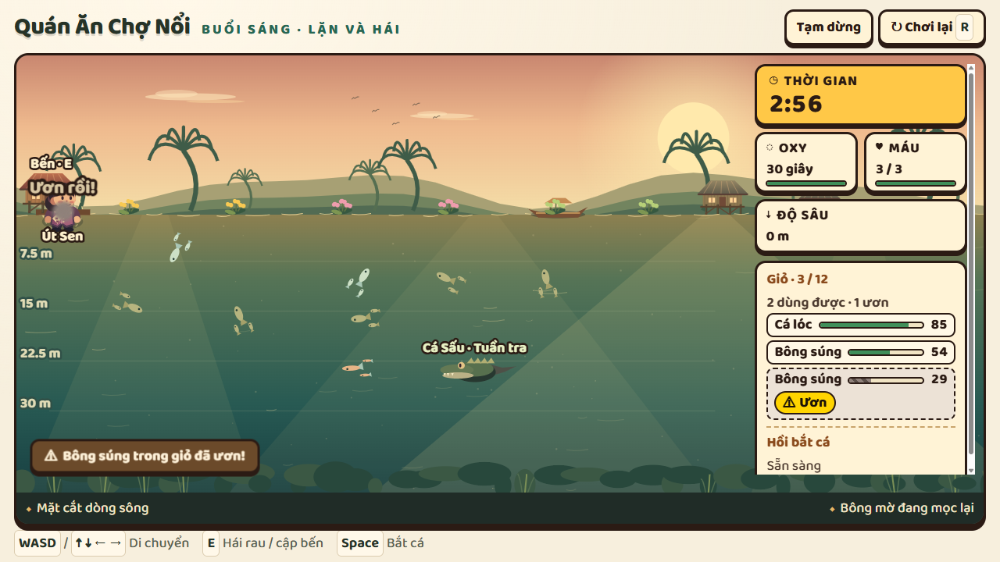
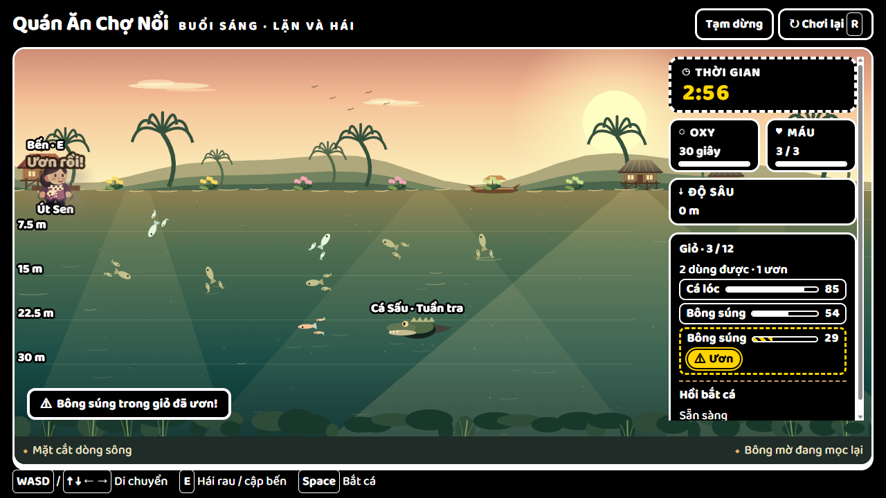
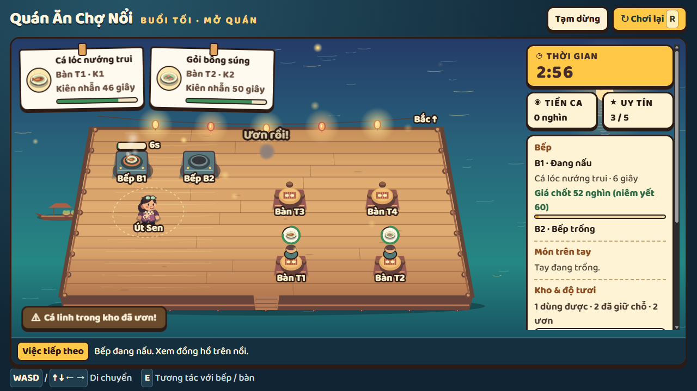
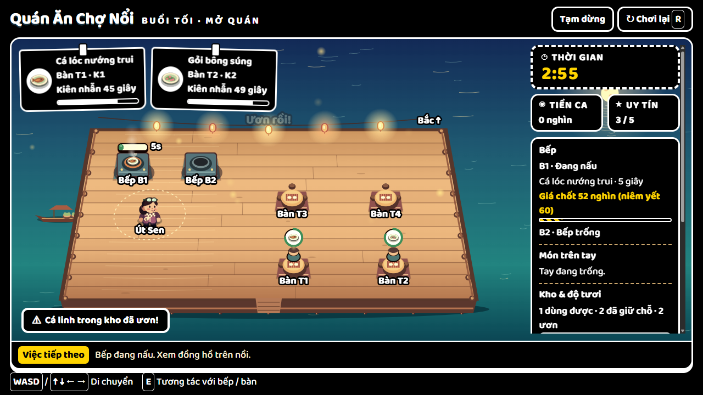
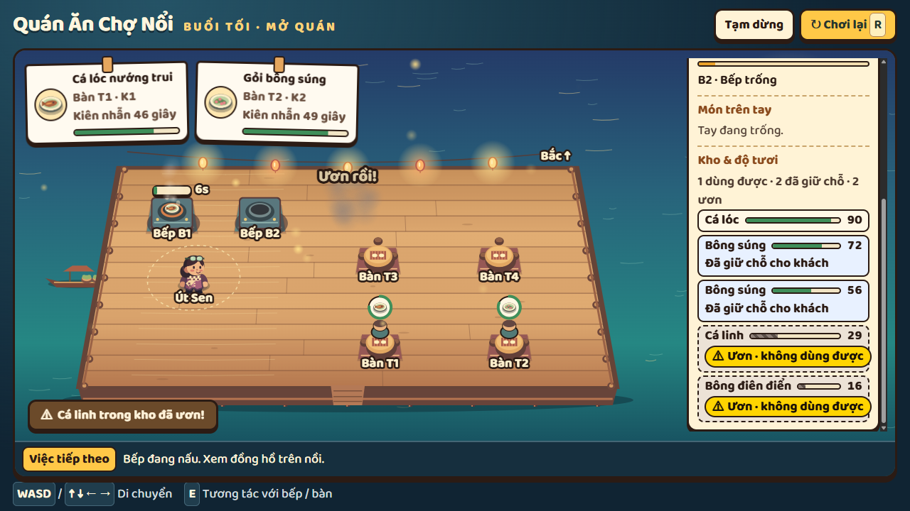
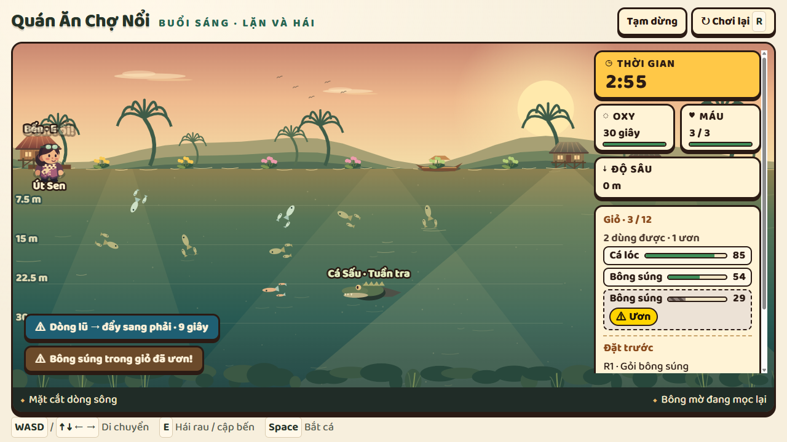

# Bằng chứng Phase 3: HUD độ tươi và hàng ươn (UI)

Ngày 21/11/2026, nhánh `tuancdk/p3-ui-freshness` trên `main` `3df688d` (contract v1.2), [issue #22](https://github.com/tuancdk/K5-L3B-LAB-Day12-AI-SDLC/issues/22).

Bản đầu của issue này nằm ở nhánh `codex/phase-3-ui-freshness` (`efcc300`), làm trên giao diện cũ và chỉ thử bằng fixture. Bản này chuyển phần đó lên giao diện hiện tại (HUD nổi, Phaser, tương phản cao #34) và **kiểm bằng dữ liệu v1.2 thật** từ sim: #18, #19, #20 đã merge.

## Hiển thị

**Giỏ (sáng) và kho quán (tối)**
- Mỗi cá thể `{id, kind, fresh}` là một hàng gồm tên nguyên liệu, thanh độ tươi và số (0–100).
- Số được cắt phần lẻ, nên 29,9 hiện là "29" chứ không làm tròn lên thành mốc ươn.
- Hàng ươn có viền nét đứt, thanh sọc và nhãn chữ "⚠ Ươn". Ở kho ghi thêm "Ươn · không dùng được", vì quán không giữ chỗ được hàng ươn.
- Ở kho, hàng đã giữ chỗ ghi "Đã giữ chỗ cho khách", lấy theo `customer.reserved` (mảng id).
- Dòng tóm tắt dạng "N dùng được · M đã giữ chỗ · K ươn".
- "Nguyên liệu cần lấy" ở buổi sáng chỉ đếm hàng còn dùng được.

**Ngưỡng ươn**
- Đọc `meta.freshness.spoiled_below` mà `live.py` gửi từ `tuning.freshness` của contract (đã thêm một dòng vào `meta`). Client không tự đặt số.
- Nếu meta thiếu ngưỡng, hàng được coi là ươn khi đã có event `spoiled` cho id đó.

**Event `spoiled`**
- Thông báo "⚠ Bông súng trong giỏ đã ươn!" hoặc "… trong kho đã ươn!" trong 3 s. Mỗi id chỉ báo một lần.
- Phaser tạo khói và chữ "Ươn rồi!"; có tiếng báo riêng.

**Giá chốt**
- Bếp đang nấu và món trên tay hiện "Giá chốt 52 nghìn (niêm yết 60)".
- Giá lấy từ `base_price` của payload món, hoặc của `cook_started` khớp đơn. Giá niêm yết lấy từ `menu[dish].price`.
- Khi bắt đầu nấu, Phaser hiện chữ "Chốt N nghìn" trên bếp.
- Bếp và món trên tay đặt trên phần kho để giá luôn trong tầm nhìn.

**Mở rộng (đang tắt trong contract, `extensions: []`)**
- `current`: "⚠ Dòng lũ → đẩy sang phải · N giây", cảnh báo trước "Dòng lũ sắp tới · N giây" từ `current_warning`, kèm tiếng báo.
- `reservations`: mục "Đặt trước" liệt kê R1, R2 kèm tên món.
- Cả hai được thử bằng cách chèn trường vào snapshot phía trình duyệt.

**Tương thích**
- Vẫn đọc dạng đếm `{kind: n}` và mảng tên kind cũ.
- Màn "Chuẩn bị mở quán" đếm đúng kho cá thể và ghi thêm "K đã ươn, không dùng được". Món nấu được chỉ tính hàng còn dùng được.

## Ảnh (1280×720, dữ liệu sim thật)

| | Thường | Tương phản cao |
|---|---|---|
| Sông: giỏ, cá thể 32 hao 0,5/s thành ươn |  |  |
| Quán: giá chốt, cá thể 31 hao 0,25/s thành ươn |  |  |
| Quán: kho từng cá thể (tươi / giữ chỗ / ươn) |  | |
| Mở rộng: dòng lũ + đặt trước |  | |

## Lệnh tái hiện

```powershell
python -X utf8 -B docs/proof/ui/phase-3/fresh-check.py
```

Script cần Chrome và gói `websockets`. Nó chạy `chonoi.live` với [`gather-v12-scenario.json`](gather-v12-scenario.json) và [`quan-v12-scenario.json`](quan-v12-scenario.json), rồi kiểm:
- `meta.freshness.spoiled_below` đến từ contract.
- Event `spoiled` thật sinh thông báo.
- Hàng ươn có nhãn chữ.
- Trong kho có đúng 2 cá thể giữ chỗ, và giá chốt hiện đúng.
- Chữ ≥ 18 px.
- Ở tương phản cao, hàng ươn có viền nét đứt.
- Thông báo dòng lũ và mục đặt trước hiện đúng.
- Không có lỗi JavaScript.

Kết quả lần lưu ảnh:

```
sông: "Bông súng trong giỏ đã ươn!" · it3 spoiled · chữ nhỏ nhất 18 px
quán: "Cá linh trong kho đã ươn!" · it2, it3 giữ chỗ · it4, it5 ươn · chữ nhỏ nhất 18 px
mở rộng: "Dòng lũ → đẩy sang phải · 9 giây"
```

## Sửa kèm để các kiểm tra cũ chạy trên v1.2

- `docs/proof/ui/quan-scenario.json` và `phase-2/day-live-scenario.json` chuyển sang mảng cá thể, vì sim v1.2 từ chối dạng đếm.
- `browser-check.py`:
  - Kiểm kho Ngày theo id.
  - Phần giữ chỗ dùng mảng id.
  - Kiểm tra quán tìm khách **K1 theo id**. Từ P2, quán có khách ngẫu nhiên (C1) xếp trước K1, nên `customers[0]` đọc nhầm khách. Đây là nguyên nhân của lỗi "chạy riêng chế độ quán không qua" được ghi ở PR #42 và #45; game không lỗi.
- `phase-4/ui/warnings-check.py` bỏ bước thử bench, vì #32 (PR #44) đã thay giao thức bằng `/bench-config` của `chonoi/bench.py`.

## Hồi quy

- unittest **215/215 OK** ([log](unittest.log)), gồm `tests/test_live.py`.
- `browser-check.py`: server thật buổi sáng **và quán** đều đạt; `--day-fixture` và `--day-live` đạt.
- `phaser-check.py` và `phase-4/ui/warnings-check.py`: đạt.
